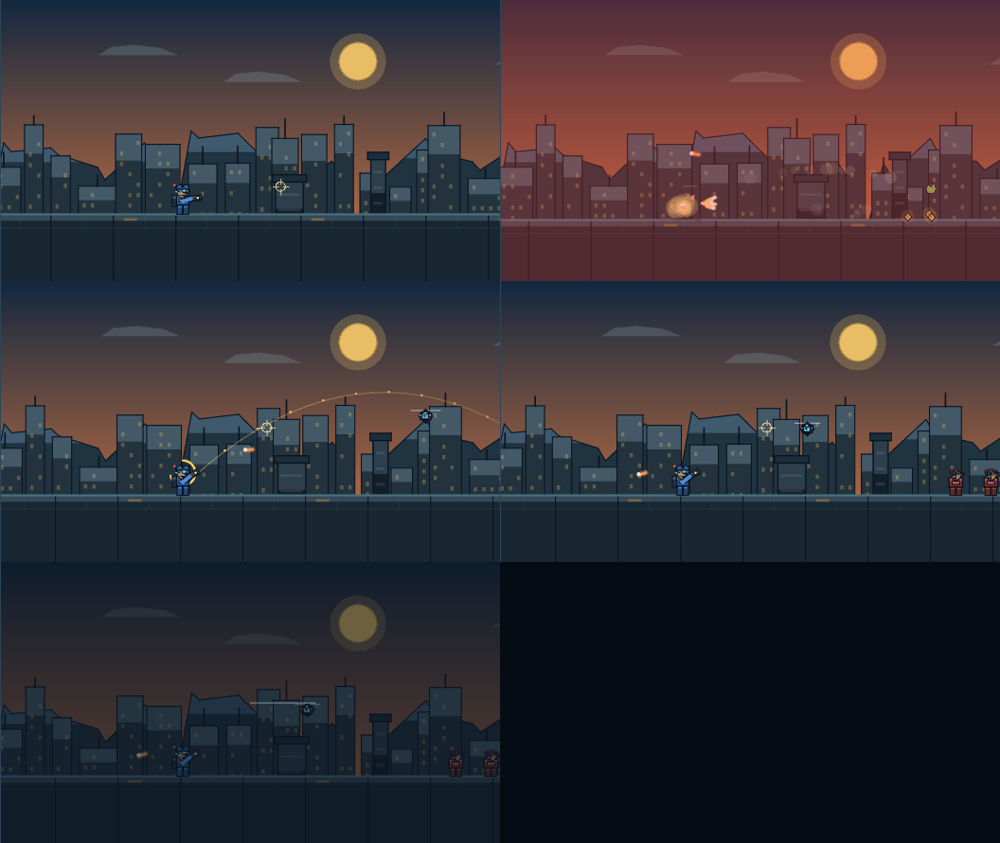

# IRON VERGE — test report & development-phase analysis

**Date:** 2026-11-16 · **Branch:** `arena/6e629b17-iron-verge-game` · **Commit:** `8a823eb`

Everything below was measured, not guessed. Repro commands are included so any
number can be re-derived after a change.

| Command | What it does |
| --- | --- |
| `npm run demo` | serves the playable demo at `http://localhost:8080/` (the LIVE PREVIEW) |
| `npm test` | 43 tests against the *shipped* engine, extracted from the HTML at run time |
| `npm run typecheck` | parses the bundle, verifies every DOM id reference, offline-safety, sizes |
| `npm run analyze` | regenerates every balance/economy number in this report |
| `npm run snapshot` | renders real `RenderFrame`s to PNG (see below) |

> **How the demo was tested without a browser.** Playwright's Chromium download is
> blocked in this sandbox (`cdn.playwright.dev` unreachable), so I did two things
> instead: `scripts/extract-engine.mjs` slices the platform-agnostic engine out of
> the single-file bundle and runs it in Node, and `scripts/rasterize-frames.py`
> is a small software rasterizer that turns the real draw-command buffers into
> PNGs. Both are checked in and part of `npm test` / `npm run snapshot`.
>
> 
> *Actual frames rendered from the engine's command buffer: opening, firefight,
> mid-charge grenade with the ballistic preview, engagement, pause veil.*

---

## 1. What is actually in the repo

The repository is **not** the project the README describes.

| README claims | Reality |
| --- | --- |
| `src/` — 83+ TS/TSX files, engine/state/services/components/native | **absent** |
| `web/` harness, `docs/screenshots/` (7 images), `scripts/build-demo.mjs`, `tests/` | **absent** |
| `npm run typecheck` → strict TS over all sources | fails: `TS18003 No inputs were found` |
| `npm test` → 15 passing tests | fails: `Cannot find module scripts/run-tests.mjs` |
| `npm run build:demo` | fails: same missing module |
| `npm run smoke` (Playwright E2E) | script missing, browser uninstallable |
| `DOWNLOAD-README.txt` says "83+ files, 7 screenshots" | 8 files total, 0 screenshots |

What *does* exist is one genuinely impressive artefact: a **185 KB self-contained
HTML demo** (131 KB engine + 32 KB browser shell + 13 KB CSS + 8.5 KB markup) with
no network dependencies. So the project's real phase is:

> **phase: playable vertical slice / architecture demo.** The simulation layer is
> production-quality; the product wrapper around it is not yet real.

A live-service title cannot ship from a single HTML file, so the missing `src/`
tree is the single biggest risk on this branch — everything the README markets as
"production-grade" (the RN UI, the Skia renderer, the StoreKit/Play Billing
bridges, the cloud save) is unverifiable because it isn't here.

---

## 2. What is genuinely strong (verified)

These are the parts that raise the project's ceiling, and they're all real:

1. **Deterministic simulation.** Two worlds with the same seed and scripted input
   produce bit-identical state after 900 steps; a different seed diverges.
   `Math.random()` appears only inside `ParticleSystem` (visual jitter), so it can
   never feed back into gameplay. This is what makes replays, server-side
   validation and anti-cheat possible later — it is the most valuable property in
   the codebase and should be protected by a CI gate.
2. **Performance headroom.** Measured `0.005 ms`/sim step and `0.19 ms`/frame
   assembly against documented budgets of 1.5 ms and 2.0 ms — **0.3%** and **9%**
   of budget. Peak 132/900 pool particles. There is enormous room for more
   entities, effects or a 120 Hz mode before touching the budgets.
3. **Renderer-agnostic command buffer.** `RenderFrame { screen, world, overlay }`
   of plain serialisable objects, consumed by Canvas2D today. Swapping in Skia (or
   recording to a picture) really is a drop-in change at the seam.
4. **Charge-throw ordnance.** Charge lives in sim state (`grenadeCharge`,
   `grenadeCharging`) not in the UI, so it's replayable. The preview is derived
   from the same `computeThrowVelocity()` the projectile uses: measured drift
   between preview and real trajectory is **0–27 px** across angles and charges,
   against a 148 px blast radius. That's honest.
5. **Swept collision.** A 1180 px/s bullet moves ~19.7 px per 60 Hz step; the
   `segmentAABB` sweep catches targets a point test would tunnel through.
6. **Art direction at almost no cost.** Faces, mech kits, a 5-layer parallax
   skyline and a toon shader expressed as 2–3 polygons per shape. 185 KB total,
   renders offline, scales to any DPR.
7. **Economy plumbing.** Deterministic 6-hour shop rotation (verified over 200
   consecutive windows: always 6 offers, always ≥1 per category, prices only ever
   discounted), single-use SSV tokens for rewarded ads, idempotency keys, server
   authority over premium currency.

---

## 3. Confirmed defects

Each item has a failing-by-design regression test in `tests/engine.test.mjs`
(`[known-bug Bn]`) that prints the diagnostic while the bug exists and **fails
loudly once it is fixed**, so the suite doubles as the fix checklist.

| # | Severity | Defect | Evidence |
| --- | --- | --- | --- |
| **B1** | 🔴 blocker | **Run scrap is never credited.** Drops require the player to physically walk within 30 px; the magnet only pulls from 175 px. Kill a grunt at range → the reward is abandoned. | 22 kills → `scrapEarned = 0`, 527–644 scrap stranded on the floor |
| **B1b** | 🔴 blocker | Drops land 400–900 px from where the player stood and expire after 14 s. | nearest abandoned drop: 439 px (magnet radius 175) |
| **B2** | 🔴 blocker | **The weapon equipped in the Armory is ignored on deploy.** `world.configure({startWeapon})` sets it, then `World.reset()` rebuilds the player with `weapon = "ar"`. | store `loadout.weapon = "shotgun"` → run starts with `"ar"` |
| **B3** | 🟠 high | **Rewarded-ad daily cap is bypassable** — `session.adClaimsToday` is not in `toPersisted()`, so a page refresh grants another 5×250 scrap. Direct revenue/abuse issue. | persisted keys lack `session`; reload granted 5 more |
| **B4** | 🟠 high | **Stale cloud save overwrites newer premium currency and level.** `resolveConflict()` keeps *remote* gears/progression regardless of revision, so a device that bought 120 Gears at rev 40 loses to a rev-3 record. | rev 40 (120 gears, L9) + rev 3 (5 gears, L4) → merges to 5 gears, L4 |
| **B5** | 🟠 high | **Store product misrepresents what it grants.** `starter_bundle` is advertised as "180 Gears + 500 Scrap Metal"; only gears are credited. Paid-content accuracy issue. | wallet scrap delta = 0 |
| **B6** | 🟠 high | **No healing of any kind, and a turret deals 22.5 dps.** A single turret kills a full-HP player in 4.4 s; one bad wave is unrecoverable, which caps run length at ~30–40 s for skilled play. | no health pickup kind exists; TTK table in §4 |
| **B11** | 🟠 high | **Grenade range is non-monotonic.** Ease-out-cubic saturates `vx` while the flatter lift shortens flight time, so range peaks at ~60% charge (655 px) and *falls* to 591 px at 100% — while the HUD says "FAR THROW · 100%". The README's "~3× range" claim is also false: it's 2.9× at the peak, 2.88× at full. | 205 → 529 → 646 → 644 → 591 px |

Non-blocking observations from reading the shell (no test — they need a browser):

* Aim state is lost on `clearAim()`; after releasing a pointer the aim direction
  falls back to facing until the stick is touched again.
* `shop-ad-free` button is defined and styled but never shown; only
  `bonus_scrap` is reachable of the 4 declared ad placements (`double_run_reward`,
  `free_revive`, `shop_discount` are dead config).
* `restorePurchases()` returns `[]` and no "Restore" control is surfaced — an App
  Store requirement.
* Level-ups grant nothing; `unlockLevel` gates are the only payoff, and only 3 of
  12 catalogue items are gated at all.
* Skin palettes (`SKIN_PALETTES`) exist in the catalogue but the renderer only
  reads the weapon/skin *id*; buying a skin changes no pixel.

---

## 4. Balance read

**Survivability.** A bot that aims at the nearest enemy and kites dies at
**29–40 s** (mean ~34 s) across six seeds, at wave 2–3. Caveat: this bot never
crouch-dodges, never uses grenades and never disengages, so a human will last
longer — treat ~34 s as the *mechanical* floor, and the shape of the problem
(one-way HP, no sustain) as the finding rather than the exact number.

| enemy | HP | bullet dps | contact | time to kill a 100 HP player |
| --- | --- | --- | --- | --- |
| grunt | 42 | — | 9 | — |
| gunner | 58 | 8.1 | 8 | 12.3 s |
| drone | 36 | 4.7 | 11 | 21.1 s |
| **turret** | 95 | **22.5** | 0 | **4.4 s** |
| brute | 260 | 13.3 | 20 | 7.5 s |

The turret is the outlier: 3-round burst × 12 dmg every 1.6 s at *any* range,
static, 95 HP — an off-screen damage source with no counterplay window and no way
to heal. Combined with `invulnerableOnHit = 0.65 s`, sustained fire from two
turrets is effectively unavoidable.

**Weapons.** Sustained DPS (including reload) tells a different story from the
spec sheet: the AR and shotgun are near-identical (96.5 vs 102.8), the "epic"
railgun is *worse* than both (67.3) and the "legendary" missile is the worst
(43.9). Raw DPS isn't the whole story — the railgun is hitscan and pierces 12,
the missile is homing with 96 px splash, both of which win on *effective* damage
against clustered or moving targets — but the headline number a player feels when
holding the trigger is inverted versus price. Treat it as a tuning signal, not a
bug: advertise the rail/missile on utility, and give them a per-shot upside the
bullet weapons can't match.

| weapon | burst dps | sustained dps | mag | reload |
| --- | --- | --- | --- | --- |
| ar | 144.7 | **96.5** | 30 | 1.45 s |
| shotgun | 146.7 | **102.8** | 8 | 2.05 s |
| railgun | 92.8 | 67.3 | 6 | 2.35 s |
| missile | 108.0 | 43.9 | 4 | 2.6 s |

**Economy.** A bot that *walks over the loot* earns **589 scrap** in a 3-minute
run; one that doesn't earns **0** (B1). Once B1 is fixed the curve is reasonable —
shotgun in 2 runs, railgun in 5 — which means the pricing is fine and the
**collection** is what's broken.

**Progression.** ~230 xp/run → level 5 after 5 runs, level 6 after 10. The
curve itself is fine; it's just that most items aren't gated and levels pay out
nothing.

---

## 5. What to add — prioritised roadmap

### Phase 0 — make the repo honest (½ day, blocking everything else)
1. **Restore `src/`** or delete the claims. Right now `App.tsx` imports
   `./src/game/GameProvider` etc. — the RN target does not compile. If the TS
   source is genuinely gone, treat the HTML as the source of truth and
   re-extract modules from it (the bundle still carries `// src/...` boundaries).
2. **Keep the new harness**: `npm test`, `npm run typecheck`, `npm run analyze`,
   `npm run demo` all pass now. Wire them into CI.
3. **Fix the README** verification table to match reality.

### Phase 1 — close the blockers (2–3 days)
4. **B1/B1b — magnet or auto-credit.** Cheapest correct fix: make `pickup` also
   spawn a "float to wallet" token that homes on the player regardless of
   distance (or credit on kill and keep drops purely cosmetic). Playtest signal
   to hit: an average run should bank ~400–700 scrap without the player detouring.
5. **B2 — carry the loadout into reset().** `reset()` should honour
   `this.pendingStartWeapon` / re-apply `configure()` state, and the store should
   be the single source of truth for loadout at run start.
6. **B3 — persist `session.adClaimsToday` + `adDayStamp`** (server-side cap in
   production, not client).
7. **B4 — revision-aware conflict resolution.** If `local.revision > remote.revision`,
   the client's assets win; never take `remote.gears` unconditionally. Gears must
   be validated server-side anyway — this client merge is a UX fallback only.
8. **B5 — grant the advertised scrap** (or fix the copy). Add an
   `assert(product description ⊆ actual grants)` test.
9. **B6 — add sustain.** Health pickups (small, from 5-kill streaks), a
   between-wave repair, or lifesteal on melee kills. Also cut turret dps to
   ~12–14 and give it a visible wind-up.
10. **B11 — re-derive the throw curve** so range is monotonic in charge
    (lower `maxThrowSpeed` and raise `longLift`, or drive lift from the *time*
    you want, not a fixed lerp).

### Phase 2 — depth that the systems already support (1–2 weeks)
11. **Enemy variety with readable answers**: a shield carrier (flank), a mortar
    (forces movement), a sapper (area denial) — the AI switch is already a clean
    per-`kind` table, so each is ~40 lines.
12. **Boss / wave-5 milestone** with an arena change; the wave director already
    ramps cadence and mix.
13. **Make unlocks visible**: apply `skinPalette` in the player renderer — a
    cosmetic purchase that changes nothing is a refund request.
14. **Meta progression with teeth**: level-ups → a perk choice (start with +1
    grenade, +10% scrap, one revive). Utilities already compose through
    `selectModifiers()`; this is catalogue + one modal.
15. **Daily/rotating objectives** ("kill 12 drones", "3 grenade multikills") fed
    by the existing `EventBus` — cheap retention with the analytics already in
    place.

### Phase 3 — live-service hardening
16. **Server-authoritative run validation**: the deterministic sim makes this
    real — upload `(seed, input stream, duration)`, replay it server-side, credit
    the run's scrap from the replay. This closes the "#1 way a run-and-gun gets
    cheated" and it's the payoff for ADR-002.
17. **Rotation refresher** + `RotationClock` so the armory actually changes while
    the app is open (nothing schedules it today).
18. **IAP compliance**: restore purchases, non-consumable `starter_bundle`
    (it's currently re-buyable), receipt validation on server.
19. **A11y & mobile**: the touch art is only 2.5% of the screen height and the tap
    targets are 26–31 CSS px tall at 540p — bump to ≥44 px, and add a colourblind
    cue on the HP/combo chips (they're colour-only today).
20. **Audio.** There is no sound at all in a live-service shooter demo; even 6
    procedural WebAudio one-shots (shot, reload, explosion, hit, pickup, level-up)
    would change the feel more than any other single change.

---

## 6. Suggested first PRs (small, reviewable)

| PR | Scope | Value |
| --- | --- | --- |
| 1 | `npm test` / `npm run typecheck` / `npm run analyze` + CI | makes the project verifiable |
| 2 | Acknowledge the missing `src/` (restore or rescope README) | trust |
| 3 | B2 + B1 (loadout on reset, auto-credit scrap) | the game becomes playable end-to-end |
| 4 | B3 + B4 + B5 (persistence & purchase integrity) | live-ops safety |
| 5 | B6 + B11 + turret dps (sustain & ordnance) | run length goes from 34 s to minutes |
| 6 | Skin palettes in renderer + level-up perks | shop has a reason to exist |

---

## Appendix · raw measurements

```
survival (bot, 6 seeds)            29–40 s, wave 2–3
sim step                          0.005 ms   (budget 1.5)   0.3%
frame assembly                    0.19 ms    (budget 2.0)   9.4%
commands per frame                638
peak live particles               132 / 900
scrap banked, greedy bot          0
scrap banked, collector bot       589 / 3 min
preview vs real grenade impact    0–27 px error (blast radius 148 px)
bullet tunneling at 60 Hz         19.7 px/step (swept collision present)
bundle                            185.2 KB  (131.6 engine / 31.8 shell / 12.9 css / 8.5 markup)
test suite                        43 tests, 43 pass, 8 known-bug diagnostics
```
